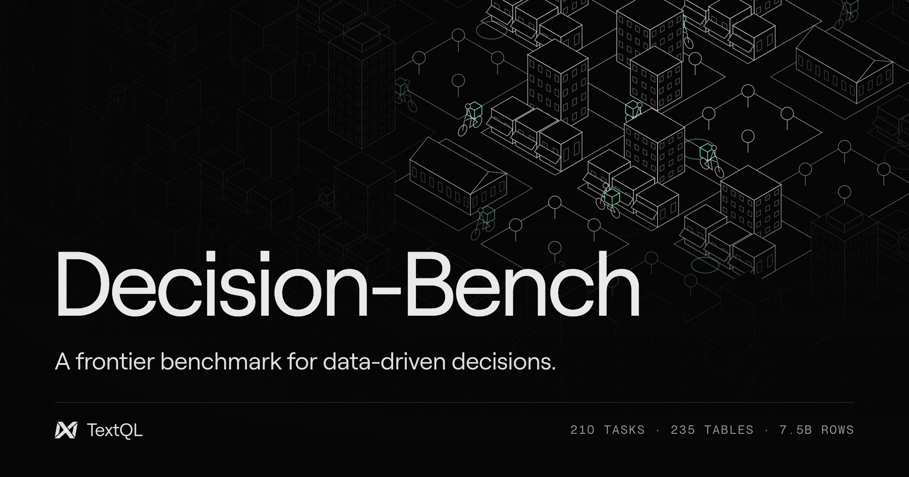

# Decision-Bench

A frontier benchmark for data-driven decisions. Decision-Bench measures whether an AI agent
can do a company's real analytical work on its data warehouse: investigate, compute, and then
**act**.

**[Leaderboard & Demo](https://textql.com/decision-bench)** · **[How it works](https://textql.com/blog/decision-bench)** ·
**[Paper](https://arxiv.org/abs/2610.02122)** · **[Data](https://huggingface.co/datasets/textql/Decision-Bench)**

## Why Decision-Bench

Enterprise data work does not end at a query. An analyst reads across dozens of tables, runs
the statistics, and then does something with the result: bans an account, books a journal
entry, sets a budget, files a forecast. Decision-Bench grades that last step.

- **Enterprise scale.** The warehouse is one simulated year of a New York City food-delivery
  company, exported in Oracle E-Business Suite form: 235 tables and 7.5 billion rows, where an
  order resolves into dispatch decisions, courier pay, merchant payouts and balanced ledger
  entries.
- **210 tasks across the business.** Fraud rings and promotion economics, the month-end
  close, courier pay, marketplace operations, dashboards and forecasting.
- **Graded on decisions, not prose.** An agent is scored on what it **files** (bans, journal
  entries, balances, forecasts, dashboard data sources), by its consequences in the simulation,
  and not on what it writes in its answer.
- **Answer keys from the simulator.** Every key comes from the simulation's own state, which
  the warehouse does not show, so the agent has to reconstruct the facts before acting on
  them. The keys are held out, so the benchmark cannot be trained on.
- **Far from saturated.** In the paper, the strongest of 14 frontier and open-weight models
  averages 59.5 points and scores 95 or more on 34.8% of the tasks. The
  [leaderboard](https://textql.com/decision-bench) has the current standings and a replay of
  the agents at work.

This repository is everything needed to run the benchmark on your own agent or model: the
questions, the reference agent on [Inspect AI](https://inspect.aisi.org.uk), its two tool
servers, the sandboxes `run_python` executes in, and the model configurations of the paper's
runs. The warehouse is on Hugging Face (see *Data*). To get a run on the leaderboard, see
*Submitting results*.

Decision-Bench is built by [TextQL](https://textql.com).

## Quickstart

```bash
git clone https://github.com/TextQLLabs/Decision-Bench.git && cd Decision-Bench
python3 -m venv .venv
.venv/bin/pip install -e '.[analysis,dev]'      # add ,bigquery for BigQuery
cp .env.example .env                             # add your model provider keys
.venv/bin/pytest                                 # offline checks, no keys or data needed
```

Check the whole path with the smoke question. It needs no data and no domain knowledge: the
prompt says exactly what to file, and the `conformance` score must be 1.

```bash
.venv/bin/inspect eval decision_bench/task.py -T questions=smoke --model anthropic/claude-haiku-4-5
```

## How a run works

Each question is one Inspect sample. The agent gets a system prompt
(`decision_bench/system_prompt.md`), the question, and the tools of two MCP servers:

| server | tools | |
| --- | --- | --- |
| warehouse | `run_sql`, `list_tables`, `describe_table` | read-only; one statement per call; every result also saved as Parquet |
| python | `run_python` | a persistent interpreter with pandas, polars, scipy, statsmodels, scikit-learn, OR-Tools |

The agent files its findings from Python through the **Mission Control** console
(`decision_bench/console/mission_control.py`, copied into each run's working directory):

```python
from mission_control import MissionControl, Reason
mission_control = MissionControl()
mission_control.ban_customers([101, 102], reason=Reason.PROMO_FARMING)
mission_control.summary()
```

Every filing is appended to the run's journal, which is stored in the Inspect log (sample
store, key `filings`). The agent loop (`decision_bench/agent.py`) is a plain tool loop: it
calls tools until it answers without one, with no planner, memory or retries.

A question with a data cutoff before December reads a warehouse that stops at the end of
that month: `food_delivery_9` is a schema of views over `food_delivery` that ends on 30
September 2024, and the system prompt says so. Queries that name any other schema are
refused.

## Data

The warehouse is released as Parquet (71 GiB) at
[huggingface.co/datasets/textql/Decision-Bench](https://huggingface.co/datasets/textql/Decision-Bench).
Download it to `data/decision-bench` and load it into a local DuckDB file with the as-of month
views:

```bash
pip install -U "huggingface_hub[hf_xet]"
hf download textql/Decision-Bench --repo-type dataset --local-dir data/decision-bench
.venv/bin/python scripts/load_duckdb.py --kit data/decision-bench --out data/decision_bench.duckdb
```

Or load it into BigQuery with the dataset's `setup/bigquery/load.sh` and
`setup/bigquery/month_views.sh` (the paper's runs used BigQuery; the dataset card has the
commands, and loaders for Snowflake, Databricks, Trino and Iceberg), then set
`DECISION_BENCH_WAREHOUSE_*` in `.env`. Give the agent a read-only credential that can see
only the benchmark's datasets.

The released warehouse is a sibling build (another random seed, same configuration) of
the one the paper's runs queried. Questions that name specific entities (courier, storefront
or promo-code ids, or counts drawn from the data) were re-drawn from the released build by
each question's own selection rule; their cards say so in `prompt_edit`, and `version` still
identifies the question as it was run. The four refund-collusion searches (`col-22-*`) were
corrected after the final run to state how their grader weighs the review, and were run again
on the new wording; their cards say so in `prompt_revision`, and `version` identifies the
corrected question.

## Running

```bash
# one model rung, all 210 questions
.venv/bin/python scripts/run.py --rung opus-5.5-high

# the same thing with plain Inspect
.venv/bin/inspect eval decision_bench/task.py --model anthropic/claude-opus-5-5 --reasoning-effort high

# a few questions, run_python in Docker
.venv/bin/python scripts/run.py --rung gpt-6-luna-low -T sandbox=docker \
    -T questions=fraud-04-stolen-orders-brooklyn,fc-08-margin

.venv/bin/python scripts/run.py --list     # the 39 rungs in rungs.json
.venv/bin/inspect view --log-dir logs
```

Task options (`-T`): `questions` (`final`, `smoke`, `reference`, a JSONL path, or
comma-separated ids), `solver` (`agent` or `reference`), `engine`, `database`, `schema`,
`credentials`, `sandbox`, `image`, `python`, `keep_workdirs`. See `decision_bench/task.py`.

### Settings of the paper's runs

| setting | value |
| --- | --- |
| harness | Inspect AI 0.3.263, reference agent, one sample per question, one epoch |
| limits | 3,600 s wall clock and 500 model turns per question |
| `run_python` | 900 s per cell, 30,000 characters of output per cell |
| `run_sql` | 300 s per query, 50-row preview, up to 1,000,000 rows saved; BigQuery scans capped at 20 GiB per query |
| models | `rungs.json`: 12 models, each at every reasoning-effort rung it supports except `max` and the no-thinking floors |
| sandbox | the Docker image's pinned libraries, in a gVisor pod with no network (`k8s/`) |

## Sandboxes

`run_python`'s interpreter never shares the warehouse or model credentials. `-T sandbox=`:

- **`local`** (default): a child process with a scrubbed environment, sharing the run's
  working directory. On macOS it runs under Seatbelt (`decision_bench/sandbox/local.sb`) and
  can read only its working directory, its venv and the kernel. On Linux it is not confined;
  use Docker.
- **`docker`**: `docker build -t decision-bench-sandbox decision_bench/sandbox`, then
  `-T sandbox=docker`. One container per run, `--network none`, 1 CPU and 8 GiB.
- **`k8s`**: one pod per run, reached with `kubectl exec`. Apply `k8s/` once
  (`kubectl apply -f k8s/`) for the namespace, the gVisor RuntimeClass,
  a deny-all NetworkPolicy, a quota and the runner's RBAC. Then push the image somewhere the
  cluster can pull it from and pass `-T sandbox=k8s -T image=<registry>/decision-bench-sandbox`.
  The pod (`k8s/templates/sandbox-pod.yaml`) runs as non-root with no service-account token,
  no DNS and no network. `inspect eval` itself stays outside the cluster, with the credentials.

Neither container shares a filesystem with the host. The console, the `run_sql` Parquet
results and the Mission Control journal travel inside the kernel's own stdin/stdout protocol
(`SyncedKernel` in `decision_bench/servers/python.py`).

## Reference solutions

`reference/` holds reference solutions for 20 of the questions: the four that the paper and
the [demo](https://textql.com/decision-bench) walk through (`col-10-refund-partnerships`,
`ds-22-margin-monthly-per-order`, `fc-12-true-ups-may`, `mer-71-silent-takeovers`) and sixteen
more. Each one is the sequence of tool calls an agent would make, with a docstring that says
what the question leaves out and the rule the solution files. `-T solver=reference` replays a
question's reference through the same two servers a model gets, with no model, and keeps what
it files like any run:

```bash
.venv/bin/inspect eval decision_bench/task.py -T solver=reference \
    -T questions=ds-22-margin-monthly-per-order --model mockllm/model
.venv/bin/inspect eval decision_bench/task.py -T solver=reference -T questions=reference \
    --model mockllm/model                          # every question that has one
```

Every statement is written for both engines. `reference/README.md` lists the solutions and
their scores on the paper's warehouse and on the released one.

## Submitting results

The answer keys are held out, so the benchmark cannot be trained on. The only score computed
here is `filed`, the share of runs that filed anything; the smoke question also reports
`conformance`. To have runs scored against the held-out keys:

```bash
.venv/bin/python scripts/export_submission.py --log-dir logs --out submissions/my-run.jsonl.gz
```

Each line is one question run: the question and its `version`, the model and its settings,
every filing, token usage, time, and how the run ended. Open an
[issue](https://github.com/TextQLLabs/Decision-Bench/issues) with the file (and optionally the
Inspect logs) to have it scored and considered for the
[leaderboard](https://textql.com/decision-bench).

## Layout

```
decision_bench/task.py         the Inspect task: questions, limits, scorers
decision_bench/agent.py        the reference agent (tool loop, per-run working directory)
decision_bench/servers/        the warehouse and python MCP servers
decision_bench/warehouse.py    read-only DuckDB / BigQuery access and month confinement
decision_bench/sandbox/        the kernel, the Docker image, the macOS Seatbelt profile
decision_bench/console/        Mission Control, the API the agent files through
decision_bench/reference.py    the reference solver: replays a reference/ solution, no model
decision_bench/system_prompt.md
tasks/final.jsonl              the 210 questions; tasks/smoke.jsonl, the conformance check
reference/                     reference solutions for 20 questions (and the smoke check)
rungs.json                     the model rungs of the paper's runs
k8s/                           the sandbox namespace, RuntimeClass, NetworkPolicy, quota, RBAC;
                               k8s/templates/, the per-run pod
scripts/                       run.py, load_duckdb.py, export_submission.py
analysis/spider2/              the paper appendix's Spider 2.0 measurements (spider2_shape.py
                               and its output); analysis/spider2/README.md says how to rerun it
analysis/reward_hacking/       three development runs that read the grader, as scrubbed traces
```

## Citation

The paper describes the benchmark under its research name, Argo-Bench.

```bibtex
@article{tomitsuka2026argobench,
  title   = {Argo-Bench: Evaluating Data Agents on Enterprise-Scale Workflows},
  author  = {Tomitsuka, Gabriel and Raayatsanati, Arman and Xing, Emma and Gand, Duke and Ma, Joseph J},
  journal = {arXiv preprint arXiv:2610.02122},
  year    = {2026}
}
```

## License

Code: Apache-2.0 (`LICENSE`). Data (question cards, the warehouse release): CC BY 4.0
(`DATA_LICENSE.md`).
